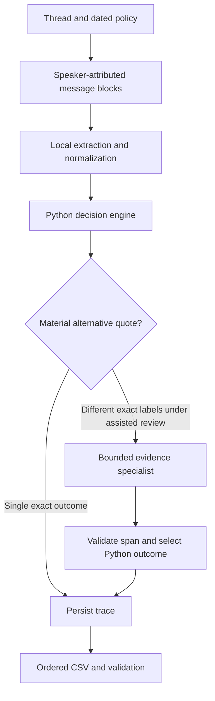

# Procurement Desk architecture

## High-level design

The competition archive is the source of the CSV records and the Acme playbook. The archive supplied here already contains the expanded playbook. The loader also understands nested archives. It validates member names, uses exclusive creation inside a temporary extraction directory, then discovers the CSV set and policy root. The CSV reader handles multiline quoted emails. The sample submission defines ID order.

The runtime retains one thread per graph invocation. A policy document fingerprint identifies the shared knowledge version. The SQLite database stores validated decision records and an ordered snapshot for offline replay. A separate DeepAgents command investigates proposed policy interpretations. Changes to the executable rules go through ordinary code edits and regression tests.

## Rule sources and precedence

Paths below are relative to the playbook root. The compiler adds a source path and line to each compiled field. It starts with the category, applies field-specific amendments in ascending effective-date order, then applies any contract cap or FX rate for the matching supplier. Dates are inclusive.

| Decision or conversion | Governing source |
|---|---|
| Missing latest usable price, blacklist, thread-wide injection, latest-message contract terms | `policies/decision-procedure.md` steps 1–4, `policies/security-policy.md`, `policies/banned-terms.md` |
| Concession and final-round rejection | `policies/decision-procedure.md` steps 5 and 7, `policies/concession-schedule.md`, category target, cap, exponent and round count |
| Whole-INR half-up counter and serialization | `policies/decision-procedure.md` step 5, `policies/output-format.md` |
| Approval value | `policies/approval-limits.md`, category or amended approval limit |
| Currency, GST, quantities, packs, billing period and reference discounts | `policies/units-and-currency.md` lines 3–24, category pack definitions, supplier contracts |
| Range endpoint | `precedents/P-01.md`, `precedents/P-04.md` |
| Free goods | `precedents/P-02.md`, `precedents/P-05.md` |
| Contract FX and billing-period examples | `precedents/P-03.md`, `precedents/P-06.md` |
| Automatic renewal and embedded reviewer instructions | `precedents/P-07.md`, `precedents/P-08.md` |

Two apparent conflicts affect implementation. The concession schedule describes the final round at walk-away, but step 7 sets the limit to target for a probationary supplier even on the final round. AMD-08 takes effect on December 4 before AMD-07 on December 5. The date controls their order. Supplier caps apply only to the named category. The hypothetical laptop contract rate in P-03 demonstrates precedence; the runtime loads the actual supplier's rate.

## Low-level design

`baseline.py` compiles Markdown field values, resolves the policy for a row, normalizes prices with Decimal, and executes the ordered decision. For target T, effective walk-away W, round r, maximum rounds R and exponent b, it computes T + (W − T) × (r − 1)^b / (R − 1)^b. The factored arithmetic avoids rounding an intermediate repeating round fraction before exponentiation. Approval uses the normalized period price times the thread quantity. For a free unit per N paid units the effective price is p × N / (N + 1).

`models.py` defines Pydantic records. Graph evidence offsets are half-open character offsets into the original thread. Each block carries a speaker, logical ID, and excerpt. The bounded reviewer uses message-relative offsets validated against the supplied block. A previous-quote discount searches only earlier messages from the named supplier. The inference graph never joins worked answers into its state.

`workflow.py` compiles a LangGraph StateGraph and persists row results. Exact outcome comparison includes the reason and counter amount. For a disputed quote, the specialist selects a grounded option and the runtime uses its Python-computed outcome. Evidence mismatch, an unavailable model, or exhausted budget produces an operational error. On an incomplete batch, the last complete submission remains available.

`integration.py` binds the reviewer to a provider registry and a thread-scoped evidence snapshot. `providers.py` uses native ChatOllama and an OpenAI-compatible LangChain adapter. Per-alias controls cover the endpoint, model IDs, credentials, timeout and concurrency. Capability probes independently exercise a synthetic chat response, a schema response, and a tool call. Direct extraction tries schema output, tool output and locally validated JSON within the shared call budget. The probe ranking measures performance on the synthetic checks. It does not establish procurement accuracy.

`audit.py` gives the DeepAgents supervisor policy/amendment, precedent, and regression-design delegates. Delegates return typed proposals with exact document lines and a reproducing case. The isolated state backend and tool middleware restrict access to the provided snapshot. Lookup tools expose bounded document sections, precedence-resolved fields, local FTS5 precedent search, message spans and precomputed outcomes. The supervisor can delegate to named specialists. Agent scratch state lasts for one invocation.

## Reproducibility, verification and limits

Final row keys bind the input to the policy fingerprint, implementation and profile configuration. SQLite commits completed rows incrementally. The export writer validates a temporary file before replacement and reopens the published file. Validation checks the header, exact IDs and order, duplicates, action/reason pairs, the terminal colon and integer price format. Comparing replay and exported bytes tests the CSV serialization path.

The public examples cover 11 of 15 categories. Courier services, security guards, printer paper and cloud servers have independent fixtures. The full dataset also contains 201 word prices, 115 dozen quotes, 71 volume conditions and nine per-100 quotes, all absent from the worked set. The coverage report records overlapping slices. Worked accuracy measures regression against public labels after development. Full-batch success measures completion and file validity. The hidden score requires manual submission.

Review routing is specialized to supported quote disputes. Free-form contract interpretation and novel unsupported email structures can exceed local extraction coverage. A live tool-capable model is needed to measure delegation quality or hosted latency.
